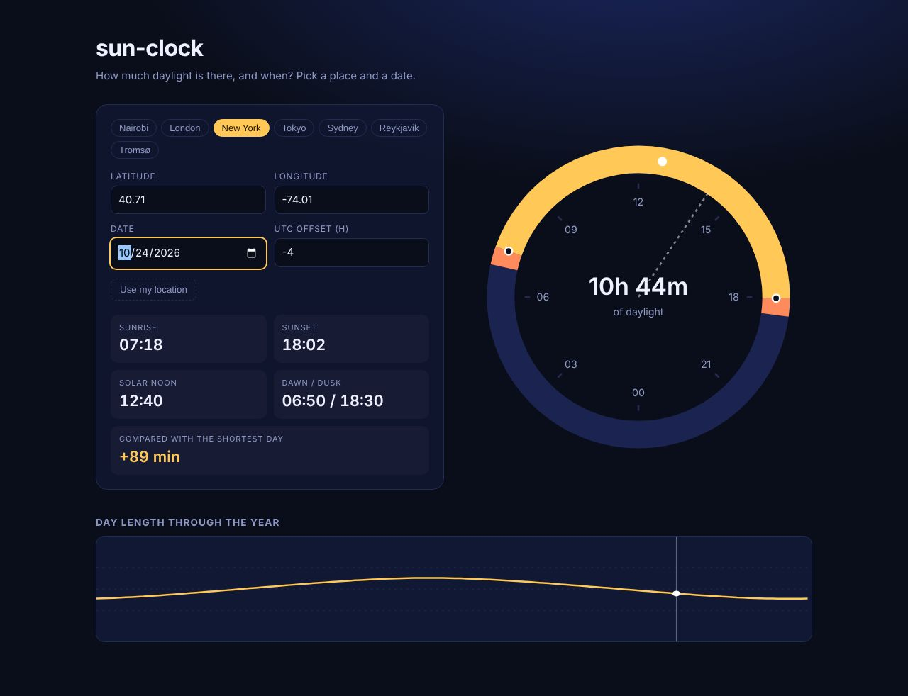

# sun-clock

Planning around daylight (travel, photography, a run after work) takes more than a sunrise time. See sunrise, sunset, dawn, dusk and day length for any place and date.

**Live:** https://sammy1-com.github.io/sun-clock/

Plain HTML, CSS and JS. Open `index.html`, no build step.

Uses the standard sunrise equation, good to a couple of minutes away from the poles. Everything is computed in the browser, no API calls.
